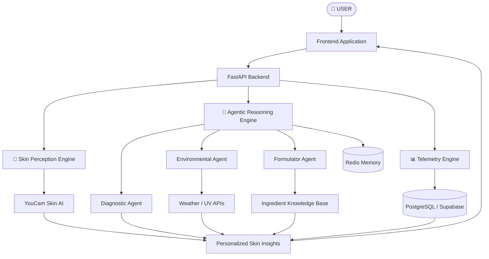

# 🧬 DERMA-PILOT AI
### The Future of Personalized Skincare Intelligence

<p align="center">
  
  
  
  
</p>

<p align="center">
  <b>Analyze. Understand. Personalize. Evolve.</b>
  <br/>
  An intelligent AI skincare companion combining skin analysis, environmental intelligence, ingredient evaluation, and personalized skincare insights.
</p>

---

## ✨ About the Project

**Derma-Pilot AI** is an agentic skincare intelligence platform designed to make personalized skincare smarter, more contextual, and accessible.

Unlike conventional skincare applications that rely on one-time image analysis and generic recommendations, Derma-Pilot AI aims to create a continuous intelligence system that considers skin metrics, environmental conditions, skincare formulations, and historical progress.

By combining **YouCam Skin AI, specialized AI agents, and structured skincare knowledge**, the platform transforms skin analysis into actionable, data-informed skincare insights.

> *Your skin is unique. Your skincare intelligence should be too.*

---

## 💎 What Makes Derma-Pilot Different?

<table>
<tr>
<td width="50%">

### 🔬 Intelligent Skin Analysis
AI-powered skin metric extraction using YouCam Skin AI.

</td>
<td width="50%">

### 🤖 Agentic Intelligence
Multiple specialized agents collaborate to generate contextual insights.

</td>
</tr>
<tr>
<td width="50%">

### 🌤️ Environmental Awareness
Weather, humidity, pollen, and UV information provide additional context.

</td>
<td width="50%">

### 🧪 Ingredient Intelligence
Analyzes INCI ingredient lists and evaluates potential compatibility concerns.

</td>
</tr>
<tr>
<td width="50%">

### 📈 Continuous Tracking
Stores historical skin metrics to support progress visualization.

</td>
<td width="50%">

### 🛍️ Product Intelligence
Connects product formulations with ingredient information and product discovery.

</td>
</tr>
</table>

---

## 🧠 The Intelligence Behind Derma-Pilot

The platform is designed around three interconnected intelligence engines.

### 01 — Skin Perception Engine
<sub>POWERED BY YOUCAM SKIN AI</sub>

The perception layer transforms uploaded skin images into structured analytical data.

- Spot density analysis
- Wrinkle depth analysis
- Moisture indexes
- Redness analysis
- Acne classification

### 02 — Agentic Reasoning Engine
<sub>MULTI-AGENT INTELLIGENCE</sub>

A coordinated system of specialized agents.

| Agent | Responsibility |
|---|---|
| 🔬 Diagnostic Agent | Interprets skin analysis metrics. |
| 🌤️ Environmental Agent | Evaluates weather and environmental conditions. |
| 🧪 Formulator Agent | Evaluates skincare ingredients and compatibility. |

### 03 — Skin Telemetry Engine
<sub>HISTORICAL INTELLIGENCE</sub>

A dedicated tracking layer designed to maintain skin analysis records and identify changes over time.

- Historical analysis records
- Skin metric comparisons
- Product usage tracking
- Progress visualization

---

## 🏗️ System Architecture



---

## ⚡ How It Works

| Step | Process |
|---|---|
| 01 | 📸 User uploads a skin image. |
| 02 | 🔬 YouCam Skin AI extracts skin-related metrics. |
| 03 | 🤖 Specialized agents process relevant information. |
| 04 | 🌤️ Environmental context is evaluated. |
| 05 | 🧪 Ingredient information is analyzed. |
| 06 | 📊 Historical data is maintained for tracking. |
| 07 | ✨ Contextual skincare insights are presented. |

---

## 🛠️ Technology Stack

<p align="center">
  
</p>

| Component | Technology |
|---|---|
| Frontend | React / Next.js |
| Styling | Tailwind CSS |
| Language | TypeScript / JavaScript |
| Backend | Python / FastAPI |
| Skin Analysis | YouCam Skin AI API |
| LLM Integration | Groq API |
| Agent Framework | LangGraph / LangChain |
| Database | PostgreSQL / Supabase |
| Memory | Redis |
| External APIs | Weather / UV APIs |

*The table describes the intended architecture; update it to reflect the integrations currently implemented.*

---

## 📂 Project Structure

```text
DERMA-PILOT-AI/
│
├── frontend/
│   ├── public/
│   ├── src/
│   │   ├── components/
│   │   ├── pages/
│   │   ├── assets/
│   │   └── styles/
│   └── package.json
│
├── backend/
│   ├── app/
│   │   ├── agents/
│   │   ├── routes/
│   │   ├── services/
│   │   ├── database/
│   │   └── main.py
│   └── requirements.txt
│
├── datasets/
│   ├── ingredient_knowledge/
│   └── product_catalog/
│
├── .env.example
├── .gitignore
└── README.md
```

*Illustrative structure — adapt to the actual repository.*

---

## 🚀 Getting Started

### Prerequisites

- Python 3.11+
- Node.js and npm
- Git
- Required API credentials

### 1. Clone the repository

```bash
git clone https://github.com/YOUR_USERNAME/DERMA-PILOT-AI.git
cd DERMA-PILOT-AI
```

### 2. Install frontend dependencies

```bash
cd frontend
npm install
npm run dev
```

### 3. Configure the backend

```bash
cd backend
python -m venv venv
```

**Windows**

```powershell
venv\Scripts\activate
```

Install dependencies:

```bash
pip install -r requirements.txt
```

Start the backend:

```bash
uvicorn app.main:app --reload
```

### 4. Environment configuration

Create a `.env` file using the following template:

```env
GROQ_API_KEY=your_groq_api_key
GROQ_MODEL=your_model_name

YOUCAM_API_KEY=your_youcam_api_key

DATABASE_URL=your_database_url
REDIS_URL=your_redis_url

WEATHER_API_KEY=your_weather_api_key
```

<sub>Never commit API keys or environment files containing secrets.</sub>

---

## 🖥️ Application Preview

<p align="center">
  <i>Screenshots of the actual application will be showcased here.</i>
</p>

<!-- Replace these placeholders with actual screenshots -->

| Dashboard | Skin Analysis |
|---|---|
| Add dashboard screenshot | Add analysis screenshot |

| AI Assistant | Progress Tracking |
|---|---|
| Add assistant screenshot | Add tracking screenshot |

---

## 🗺️ Development Roadmap

- [x] Project concept and architecture design
- [ ] Frontend and backend integration
- [ ] YouCam Skin AI integration
- [ ] Diagnostic agent
- [ ] Environmental intelligence agent
- [ ] Ingredient compatibility engine
- [ ] Historical skin telemetry
- [ ] Personalized recommendation engine
- [ ] End-to-end testing
- [ ] Deployment

---

## 🔐 Security & Responsible AI

- Secure API credential management.
- Backend-controlled external API communication.
- Appropriate protection of user images and personal information.
- Controlled database access.
- Clear communication of AI limitations.

### Medical Disclaimer

Derma-Pilot AI is an informational skincare assistance platform, not a medical diagnostic system. Its outputs are not a substitute for professional medical advice, diagnosis, or treatment. Consult a qualified dermatologist for persistent or concerning skin conditions.

---

## 🤝 Contributing

Contributions and suggestions are welcome!

1. Fork the repository.
2. Create a feature branch.
3. Commit your changes.
4. Push your branch.
5. Open a Pull Request.

---

## 🏆 Built For Innovation

<p align="center">

**YouCam API Hackathon · AI Skin AI Track**

### 🧬 DERMA-PILOT AI

*Understand Your Skin. Empower Your Decisions.*

**Building a smarter future for personalized skincare.**

</p>

---

<p align="center">
  <sub>Made with intelligence, innovation, and a vision for better skincare.</sub>
</p>
